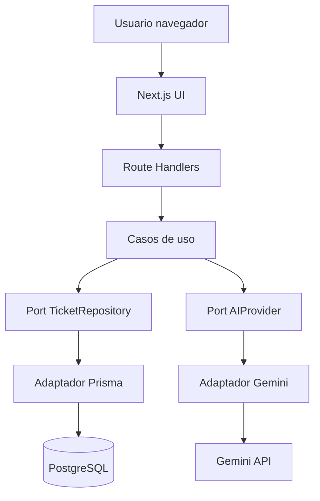
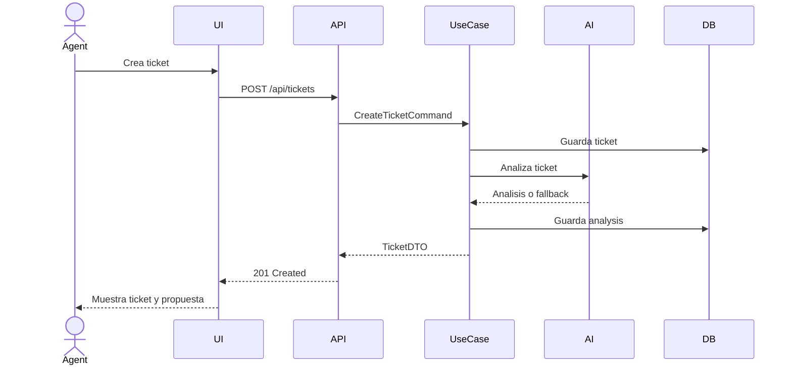
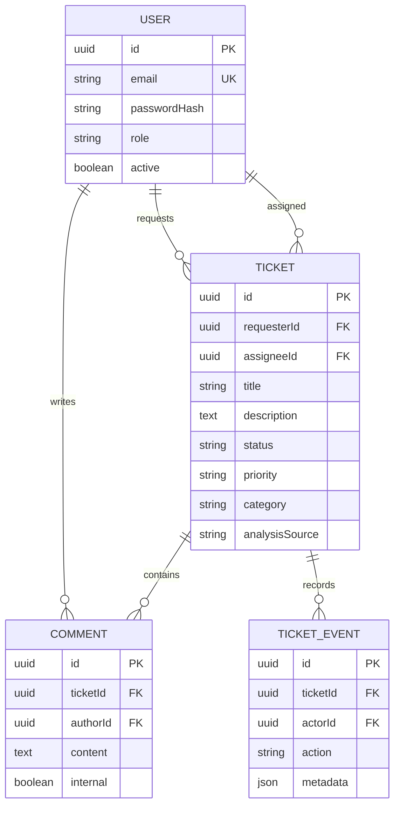
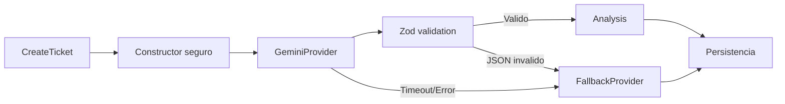
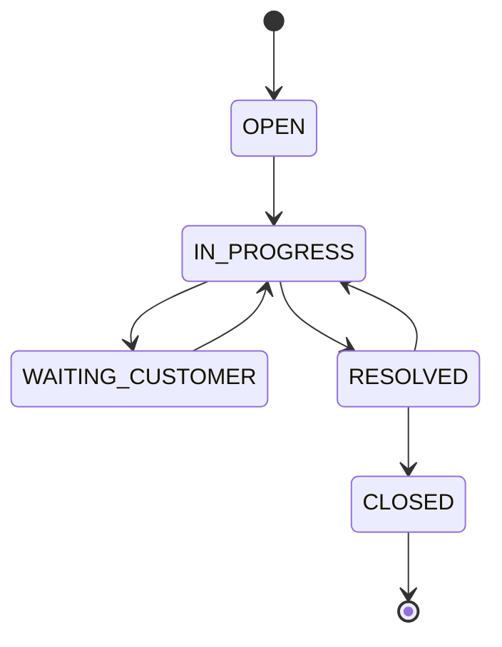

# InsightDesk AI - Arquitectura

## Principios

La solucion aplica Clean Architecture, SOLID, DRY, KISS y Separation of Concerns. Las reglas de negocio no dependen de Next.js, Prisma ni Gemini. Las interfaces de salida permiten sustituir persistencia y proveedor IA mediante Dependency Injection.

## Clean Architecture

```text
src/
  app/
    (public)/
    dashboard/
    api/
  core/
    domain/
      entities/
      value-objects/
      errors/
    application/
      ports/
      use-cases/
      dtos/
  infrastructure/
    database/
    auth/
    ai/
    logging/
  interface/
    components/
    hooks/
    presenters/
  shared/
```

### Dependencias permitidas

- `domain` no importa capas externas.
- `application` importa solo `domain` y sus propios puertos.
- `infrastructure` implementa puertos de application.
- `app` e `interface` conectan casos de uso con UI y HTTP.

## Diagrama de componentes



## Flujo frontend-backend



## Modelo de datos



## Dise単o de APIs

| Metodo | Ruta | Descripcion |
|---|---|---|
| POST | `/api/auth/register` | Crear cuenta |
| POST | `/api/auth/login` | Iniciar sesion |
| POST | `/api/auth/logout` | Cerrar sesion |
| GET | `/api/tickets` | Listar tickets paginados |
| POST | `/api/tickets` | Crear ticket |
| GET | `/api/tickets/:id` | Obtener detalle |
| PATCH | `/api/tickets/:id` | Cambiar estado, asignacion o datos |
| GET | `/api/tickets/:id/comments` | Listar comentarios |
| POST | `/api/tickets/:id/comments` | Crear comentario |
| GET | `/api/dashboard/metrics` | Obtener metricas |

Las respuestas usan un envelope consistente:

```json
{
  "data": {},
  "error": null
}
```

Los errores usan codigo, mensaje y detalles opcionales.

## Integracion con Gemini

Gemini se implementa tras `AIProvider`. El prompt recibe solo titulo y descripcion necesarios, pide JSON estricto y valida la salida con Zod. Limites:

- Timeout configurable.
- Dos reintentos como maximo.
- Sin reintento ante validacion de clave.
- Fallback con categoria `GENERAL`, prioridad `MEDIUM`, resumen disponible y respuesta neutral.
- `source = gemini | fallback`.
- Ninguna clave se envia al navegador.



## Autenticacion

El MVP usa usuarios locales y sesiones JWT almacenadas en cookies HttpOnly. Las rutas API verifican:

- Sesion valida.
- Rol permitido.
- Propiedad o asignacion para recursos clientes/agentes.
- Token activo.

Roles:

- `CUSTOMER`: crea y consulta sus tickets.
- `AGENT`: gestiona tickets asignados y todos los tickets segun alcance.
- `SUPERVISOR`: consulta metricas.
- `ADMIN`: administra usuarios y configuracion.

## Patrones de diseño utilizados

- Repository: abstrae Prisma.
- Adapter: integra Gemini y autenticacion.
- Factory: crea casos de uso con dependencias.
- DTO: limita datos entre API y UI.
- Strategy: permite cambiar proveedor IA.
- Result/Use Case: comunica errores sin depender de HTTP.
- Dependency Injection: conecta puertos e implementaciones.
- State: gobierna transiciones validas de tickets.

## Estados de ticket


